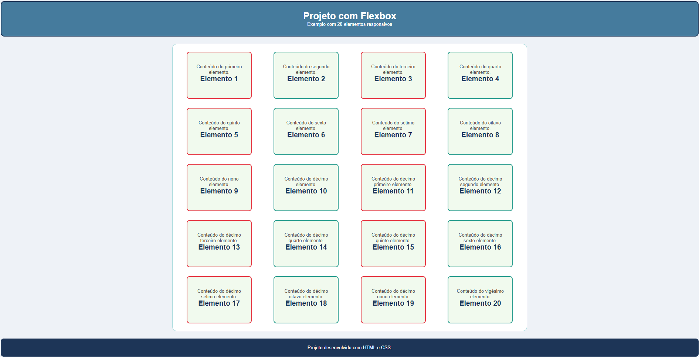

# Atividade 01 - HTML e CSS (Flexbox)

Página de exemplo com 20 cards responsivos, construída com **HTML5** e **CSS3**. O layout usa Flexbox para organizar o cabeçalho, a área principal com os cards e o rodapé. Os cards se reorganizam conforme a largura da tela, passando de linhas com várias colunas para uma coluna única em celulares.

## Tecnologias

- HTML5
- CSS3 (arquivo externo, vinculado pela tag `<link>`)
- Flexbox

## Estrutura do projeto

```
Atividade 01 - HTML e CSS/
├── assets/
│   └── print-aplicacao.png
├── index.html
└── style.css
```

## Como executar

1. Baixe ou clone a pasta do projeto.
2. Abra o arquivo `index.html` em qualquer navegador.

## Código

### index.html

```html
<!DOCTYPE html>
<html lang="pt-BR">
<head>
  <meta charset="UTF-8">
  <meta name="viewport" content="width=device-width, initial-scale=1.0">
  <title>Projeto Flexbox</title>
  <link rel="stylesheet" href="style.css">
</head>
<body>

  <header class="cabecalho">
    <h1>Projeto com Flexbox</h1>
    <p>Exemplo com 20 elementos responsivos</p>
  </header>

  <main class="container">

    <article class="card card-1">
      <h2>Elemento 1</h2>
      <p>Conteúdo do primeiro elemento.</p>
    </article>

    <article class="card card-2">
      <h2>Elemento 2</h2>
      <p>Conteúdo do segundo elemento.</p>
    </article>

    <article class="card card-3">
      <h2>Elemento 3</h2>
      <p>Conteúdo do terceiro elemento.</p>
    </article>

    <article class="card card-4">
      <h2>Elemento 4</h2>
      <p>Conteúdo do quarto elemento.</p>
    </article>

    <article class="card card-5">
      <h2>Elemento 5</h2>
      <p>Conteúdo do quinto elemento.</p>
    </article>

    <article class="card card-6">
      <h2>Elemento 6</h2>
      <p>Conteúdo do sexto elemento.</p>
    </article>

    <article class="card card-7">
      <h2>Elemento 7</h2>
      <p>Conteúdo do sétimo elemento.</p>
    </article>

    <article class="card card-8">
      <h2>Elemento 8</h2>
      <p>Conteúdo do oitavo elemento.</p>
    </article>

    <article class="card card-9">
      <h2>Elemento 9</h2>
      <p>Conteúdo do nono elemento.</p>
    </article>

    <article class="card card-10">
      <h2>Elemento 10</h2>
      <p>Conteúdo do décimo elemento.</p>
    </article>

    <article class="card card-11">
      <h2>Elemento 11</h2>
      <p>Conteúdo do décimo primeiro elemento.</p>
    </article>

    <article class="card card-12">
      <h2>Elemento 12</h2>
      <p>Conteúdo do décimo segundo elemento.</p>
    </article>

    <article class="card card-13">
      <h2>Elemento 13</h2>
      <p>Conteúdo do décimo terceiro elemento.</p>
    </article>

    <article class="card card-14">
      <h2>Elemento 14</h2>
      <p>Conteúdo do décimo quarto elemento.</p>
    </article>

    <article class="card card-15">
      <h2>Elemento 15</h2>
      <p>Conteúdo do décimo quinto elemento.</p>
    </article>

    <article class="card card-16">
      <h2>Elemento 16</h2>
      <p>Conteúdo do décimo sexto elemento.</p>
    </article>

    <article class="card card-17">
      <h2>Elemento 17</h2>
      <p>Conteúdo do décimo sétimo elemento.</p>
    </article>

    <article class="card card-18">
      <h2>Elemento 18</h2>
      <p>Conteúdo do décimo oitavo elemento.</p>
    </article>

    <article class="card card-19">
      <h2>Elemento 19</h2>
      <p>Conteúdo do décimo nono elemento.</p>
    </article>

    <article class="card card-20">
      <h2>Elemento 20</h2>
      <p>Conteúdo do vigésimo elemento.</p>
    </article>

  </main>

  <footer class="rodape">
    <p>Projeto desenvolvido com HTML e CSS.</p>
  </footer>

</body>
</html>
```

### style.css

```css
/* Reset básico */
* {
  box-sizing: border-box;
  margin: 0;
  padding: 0;
}

/* Configurações gerais */
body {
  min-height: 100vh;
  padding: 20px;
  background-color: #eef2f7;
  color: #222;
  font-family: Arial, sans-serif;

  /* Flexbox 1 e 2 */
  display: flex;
  flex-direction: column;
}

/* Cabeçalho */
.cabecalho {
  padding: 30px;
  margin-bottom: 25px;
  border: 3px solid #1d3557;
  border-radius: 12px;
  background-color: #457b9d;
  color: white;
  text-align: center;

  /* Flexbox 3 a 6 */
  display: flex;
  flex-direction: column;
  justify-content: center;
  align-items: center;
  align-content: center;
}

/* Área principal */
.container {
  width: 100%;
  max-width: 1200px;
  margin: 0 auto;
  padding: 20px;
  border: 2px solid #a8dadc;
  border-radius: 15px;
  background-color: #ffffff;

  /* Flexbox 7 a 12 */
  display: flex;
  flex-direction: row;
  flex-wrap: wrap;
  justify-content: space-around;
  align-items: stretch;
  align-content: space-evenly;
  gap: 20px;
}

/* Cada um dos 20 elementos */
.card {
  /*
    Content:
    O conteúdo está definido no HTML por meio dos elementos h2 e p.
  */

  width: 220px;
  min-height: 160px;

  /* Padding */
  padding-top: 20px;
  padding-right: 18px;
  padding-bottom: 20px;
  padding-left: 18px;

  /* Border */
  border-width: 3px;
  border-style: solid;
  border-color: #1d3557;
  border-radius: 10px;

  /* Margin */
  margin-top: 5px;
  margin-right: 5px;
  margin-bottom: 5px;
  margin-left: 5px;

  background-color: #f1faee;
  text-align: center;

  /* Flexbox 13 a 16 */
  display: flex;
  flex-direction: column;
  flex-wrap: nowrap;
  justify-content: center;
  align-items: center;

  transition: transform 0.3s ease, background-color 0.3s ease;
}

/* Flexbox aplicado aos filhos dos cards */
.card h2 {
  margin-bottom: 12px;
  color: #1d3557;

  /* Flexbox 17 e 18 */
  align-self: center;
  order: 1;
}

.card p {
  color: #555;

  /* Flexbox 19 e 20 */
  flex-grow: 0;
  flex-shrink: 1;
}

/* Efeito visual */
.card:hover {
  transform: translateY(-8px);
  background-color: #d8f3dc;
}

/* Cores diferentes para os elementos */
.card:nth-child(odd) {
  border-color: #e63946;
}

.card:nth-child(even) {
  border-color: #2a9d8f;
}

/* Rodapé */
.rodape {
  margin-top: 25px;
  padding: 20px;
  border: 2px solid #1d3557;
  border-radius: 10px;
  background-color: #1d3557;
  color: white;
  text-align: center;

  /* Flexbox adicional */
  display: flex;
  justify-content: center;
  align-items: center;
}

/* Responsividade para tablets */
@media (max-width: 768px) {
  body {
    padding: 10px;
  }

  .container {
    padding: 15px;
    gap: 15px;
    justify-content: center;
  }

  .card {
    width: 200px;
  }
}

/* Responsividade para celulares */
@media (max-width: 480px) {
  .cabecalho {
    padding: 20px;
  }

  .container {
    flex-direction: column;
    align-items: center;
    gap: 12px;
  }

  .card {
    width: 100%;
    max-width: 300px;
  }
}
```

## Print da aplicação



## Link do projeto

[Acessar a pasta do projeto](https://github.com/kevin3068/senai-frameworks-frontend/tree/main/Atividades/Aula%2007%20-%20Frameworks%20CSS/Atividade%2001%20-%20HTML%20e%20CSS)

## Conteúdo dos elementos

Os 20 elementos são blocos `<article>` com a classe `card`, cada um com um `<h2>` e um `<p>`. Cada card recebe valores definidos no `style.css` nas seguintes propriedades:

| Propriedade | Valores aplicados | Função |
|---|---|---|
| `width` / `min-height` | `220px` / `160px` | Definem a largura e a altura mínima do card. |
| `padding` (top, right, bottom, left) | `20px 18px 20px 18px` | Espaço interno entre a borda e o conteúdo. |
| `border-width`, `border-style`, `border-color`, `border-radius` | `3px`, `solid`, `#1d3557` (alternando com `#e63946` e `#2a9d8f`), `10px` | Definem a espessura, o estilo, a cor e o arredondamento da borda. |
| `margin` (top, right, bottom, left) | `5px` em todos os lados | Espaço externo entre o card e os elementos vizinhos. |

## Propriedades de Flexbox

| Propriedade | Seletor | Função |
|---|---|---|
| `display: flex` | `body`, `.cabecalho`, `.container`, `.card`, `.rodape` | Ativa o modo Flexbox no elemento. |
| `flex-direction` | `body` (column), `.cabecalho` (column), `.container` (row, e column em celulares), `.card` (column) | Define se os itens ficam em linha ou em coluna. |
| `flex-wrap` | `.container` (wrap), `.card` (nowrap) | Define se os itens quebram para uma nova linha quando faltar espaço. |
| `justify-content` | `.cabecalho`, `.container`, `.card`, `.rodape` | Distribui os itens no eixo principal. |
| `align-items` | `.cabecalho`, `.container`, `.card`, `.rodape` | Alinha os itens no eixo transversal. |
| `align-content` | `.cabecalho` (center), `.container` (space-evenly) | Distribui as linhas quando há quebra de linha. |
| `gap` | `.container` | Define o espaço entre os cards. |
| `align-self` | `.card h2` | Alinha um item individualmente, sobrescrevendo o `align-items` do pai. |
| `order` | `.card h2` | Altera a ordem visual do item sem mudar o HTML. |
| `flex-grow` | `.card p` | Define quanto o item cresce para ocupar o espaço livre. |
| `flex-shrink` | `.card p` | Define quanto o item encolhe quando falta espaço. |

## Responsividade

| Largura da tela | Alterações |
|---|---|
| Até 768px (tablets) | O `body` reduz o padding para 10px, o `.container` usa `gap` de 15px e centraliza os cards, e cada `.card` passa a ter 200px de largura. |
| Até 480px (celulares) | O `.container` muda para coluna, centraliza os itens e reduz o `gap` para 12px. Cada `.card` ocupa 100% da largura, com máximo de 300px. |

## Resumo

O projeto usa Flexbox em cabeçalho, área principal, cards e rodapé, combinado com media queries para adaptar o layout a tablets e celulares.
