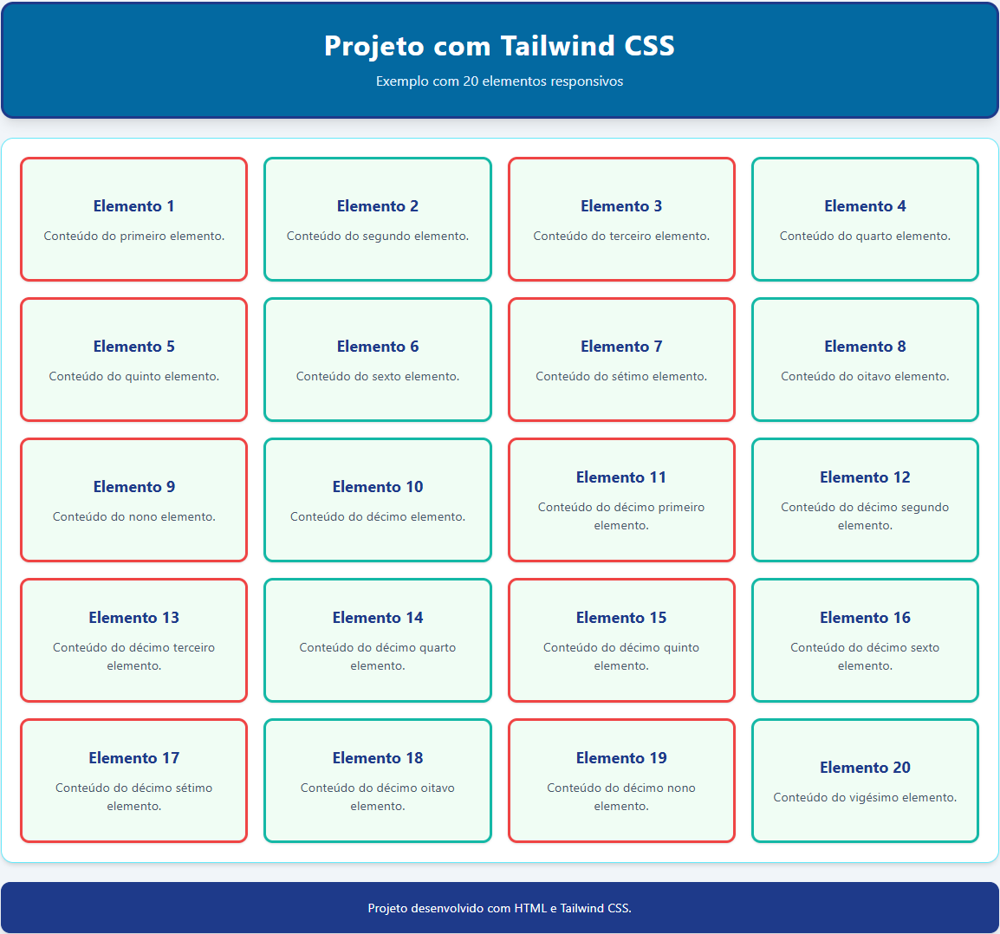

# Projeto 2 - Tailwind CSS

Página de exemplo com 20 cards responsivos, construída com **Tailwind CSS**. O layout usa Grid para organizar os cards e Flexbox para centralizar o conteúdo de cada um. Os cards se adaptam a telas pequenas, médias e grandes, e ganham efeito de elevação ao passar o mouse.

## Tecnologias

- HTML5
- Tailwind CSS (carregado via CDN no `index.html`)

## Estrutura do projeto

```
Atividade 02 - HTML e Tailwind/
├── assets/
│   └── print-aplicacao.png
├── index.html
├── package-lock.json
├── package.json
└── style.css
```

## Como executar

1. Abra o arquivo `index.html` em qualquer navegador.
2. Não é necessário instalar dependências, pois o Tailwind é carregado pelo CDN.

## Prints

### Código

```html
<!DOCTYPE html>
<html lang="pt-BR">
<head>
  <meta charset="UTF-8">
  <meta name="viewport" content="width=device-width, initial-scale=1.0">

  <title>Projeto Tailwind CSS</title>

  <script src="https://cdn.tailwindcss.com"></script>
</head>

<body class="min-h-screen bg-slate-100 p-4 text-slate-800 sm:p-6">

  <!-- Cabeçalho -->
  <header
    class="mx-auto mb-6 flex max-w-7xl flex-col items-center justify-center rounded-2xl border-4 border-blue-900 bg-sky-700 p-6 text-center text-white shadow-lg sm:p-8"
  >
    <h1 class="text-2xl font-bold tracking-wide sm:text-4xl">
      Projeto com Tailwind CSS
    </h1>

    <p class="mt-3 text-sm text-sky-100 sm:text-lg">
      Exemplo com 20 elementos responsivos
    </p>
  </header>

  <!-- Área principal -->
  <main
    class="mx-auto grid max-w-7xl grid-cols-1 gap-5 rounded-2xl border-2 border-cyan-300 bg-white p-4 shadow-md sm:grid-cols-2 sm:p-6 md:grid-cols-3 lg:grid-cols-4"
  >

    <!-- Card 1 -->
    <article
      class="group flex min-h-40 flex-col items-center justify-center rounded-xl border-4 border-red-500 bg-green-50 p-5 text-center shadow transition duration-300 hover:-translate-y-2 hover:bg-green-100 hover:shadow-xl"
    >
      <h2 class="mb-3 text-xl font-bold text-blue-900">Elemento 1</h2>
      <p class="text-slate-600">Conteúdo do primeiro elemento.</p>
    </article>

    <!-- Card 2 -->
    <article
      class="group flex min-h-40 flex-col items-center justify-center rounded-xl border-4 border-teal-500 bg-green-50 p-5 text-center shadow transition duration-300 hover:-translate-y-2 hover:bg-green-100 hover:shadow-xl"
    >
      <h2 class="mb-3 text-xl font-bold text-blue-900">Elemento 2</h2>
      <p class="text-slate-600">Conteúdo do segundo elemento.</p>
    </article>

    <!-- Card 3 -->
    <article
      class="group flex min-h-40 flex-col items-center justify-center rounded-xl border-4 border-red-500 bg-green-50 p-5 text-center shadow transition duration-300 hover:-translate-y-2 hover:bg-green-100 hover:shadow-xl"
    >
      <h2 class="mb-3 text-xl font-bold text-blue-900">Elemento 3</h2>
      <p class="text-slate-600">Conteúdo do terceiro elemento.</p>
    </article>

    <!-- Card 4 -->
    <article
      class="group flex min-h-40 flex-col items-center justify-center rounded-xl border-4 border-teal-500 bg-green-50 p-5 text-center shadow transition duration-300 hover:-translate-y-2 hover:bg-green-100 hover:shadow-xl"
    >
      <h2 class="mb-3 text-xl font-bold text-blue-900">Elemento 4</h2>
      <p class="text-slate-600">Conteúdo do quarto elemento.</p>
    </article>

    <!-- Card 5 -->
    <article
      class="group flex min-h-40 flex-col items-center justify-center rounded-xl border-4 border-red-500 bg-green-50 p-5 text-center shadow transition duration-300 hover:-translate-y-2 hover:bg-green-100 hover:shadow-xl"
    >
      <h2 class="mb-3 text-xl font-bold text-blue-900">Elemento 5</h2>
      <p class="text-slate-600">Conteúdo do quinto elemento.</p>
    </article>

    <!-- Card 6 -->
    <article
      class="group flex min-h-40 flex-col items-center justify-center rounded-xl border-4 border-teal-500 bg-green-50 p-5 text-center shadow transition duration-300 hover:-translate-y-2 hover:bg-green-100 hover:shadow-xl"
    >
      <h2 class="mb-3 text-xl font-bold text-blue-900">Elemento 6</h2>
      <p class="text-slate-600">Conteúdo do sexto elemento.</p>
    </article>

    <!-- Card 7 -->
    <article
      class="group flex min-h-40 flex-col items-center justify-center rounded-xl border-4 border-red-500 bg-green-50 p-5 text-center shadow transition duration-300 hover:-translate-y-2 hover:bg-green-100 hover:shadow-xl"
    >
      <h2 class="mb-3 text-xl font-bold text-blue-900">Elemento 7</h2>
      <p class="text-slate-600">Conteúdo do sétimo elemento.</p>
    </article>

    <!-- Card 8 -->
    <article
      class="group flex min-h-40 flex-col items-center justify-center rounded-xl border-4 border-teal-500 bg-green-50 p-5 text-center shadow transition duration-300 hover:-translate-y-2 hover:bg-green-100 hover:shadow-xl"
    >
      <h2 class="mb-3 text-xl font-bold text-blue-900">Elemento 8</h2>
      <p class="text-slate-600">Conteúdo do oitavo elemento.</p>
    </article>

    <!-- Card 9 -->
    <article
      class="group flex min-h-40 flex-col items-center justify-center rounded-xl border-4 border-red-500 bg-green-50 p-5 text-center shadow transition duration-300 hover:-translate-y-2 hover:bg-green-100 hover:shadow-xl"
    >
      <h2 class="mb-3 text-xl font-bold text-blue-900">Elemento 9</h2>
      <p class="text-slate-600">Conteúdo do nono elemento.</p>
    </article>

    <!-- Card 10 -->
    <article
      class="group flex min-h-40 flex-col items-center justify-center rounded-xl border-4 border-teal-500 bg-green-50 p-5 text-center shadow transition duration-300 hover:-translate-y-2 hover:bg-green-100 hover:shadow-xl"
    >
      <h2 class="mb-3 text-xl font-bold text-blue-900">Elemento 10</h2>
      <p class="text-slate-600">Conteúdo do décimo elemento.</p>
    </article>

    <!-- Card 11 -->
    <article
      class="group flex min-h-40 flex-col items-center justify-center rounded-xl border-4 border-red-500 bg-green-50 p-5 text-center shadow transition duration-300 hover:-translate-y-2 hover:bg-green-100 hover:shadow-xl"
    >
      <h2 class="mb-3 text-xl font-bold text-blue-900">Elemento 11</h2>
      <p class="text-slate-600">Conteúdo do décimo primeiro elemento.</p>
    </article>

    <!-- Card 12 -->
    <article
      class="group flex min-h-40 flex-col items-center justify-center rounded-xl border-4 border-teal-500 bg-green-50 p-5 text-center shadow transition duration-300 hover:-translate-y-2 hover:bg-green-100 hover:shadow-xl"
    >
      <h2 class="mb-3 text-xl font-bold text-blue-900">Elemento 12</h2>
      <p class="text-slate-600">Conteúdo do décimo segundo elemento.</p>
    </article>

    <!-- Card 13 -->
    <article
      class="group flex min-h-40 flex-col items-center justify-center rounded-xl border-4 border-red-500 bg-green-50 p-5 text-center shadow transition duration-300 hover:-translate-y-2 hover:bg-green-100 hover:shadow-xl"
    >
      <h2 class="mb-3 text-xl font-bold text-blue-900">Elemento 13</h2>
      <p class="text-slate-600">Conteúdo do décimo terceiro elemento.</p>
    </article>

    <!-- Card 14 -->
    <article
      class="group flex min-h-40 flex-col items-center justify-center rounded-xl border-4 border-teal-500 bg-green-50 p-5 text-center shadow transition duration-300 hover:-translate-y-2 hover:bg-green-100 hover:shadow-xl"
    >
      <h2 class="mb-3 text-xl font-bold text-blue-900">Elemento 14</h2>
      <p class="text-slate-600">Conteúdo do décimo quarto elemento.</p>
    </article>

    <!-- Card 15 -->
    <article
      class="group flex min-h-40 flex-col items-center justify-center rounded-xl border-4 border-red-500 bg-green-50 p-5 text-center shadow transition duration-300 hover:-translate-y-2 hover:bg-green-100 hover:shadow-xl"
    >
      <h2 class="mb-3 text-xl font-bold text-blue-900">Elemento 15</h2>
      <p class="text-slate-600">Conteúdo do décimo quinto elemento.</p>
    </article>

    <!-- Card 16 -->
    <article
      class="group flex min-h-40 flex-col items-center justify-center rounded-xl border-4 border-teal-500 bg-green-50 p-5 text-center shadow transition duration-300 hover:-translate-y-2 hover:bg-green-100 hover:shadow-xl"
    >
      <h2 class="mb-3 text-xl font-bold text-blue-900">Elemento 16</h2>
      <p class="text-slate-600">Conteúdo do décimo sexto elemento.</p>
    </article>

    <!-- Card 17 -->
    <article
      class="group flex min-h-40 flex-col items-center justify-center rounded-xl border-4 border-red-500 bg-green-50 p-5 text-center shadow transition duration-300 hover:-translate-y-2 hover:bg-green-100 hover:shadow-xl"
    >
      <h2 class="mb-3 text-xl font-bold text-blue-900">Elemento 17</h2>
      <p class="text-slate-600">Conteúdo do décimo sétimo elemento.</p>
    </article>

    <!-- Card 18 -->
    <article
      class="group flex min-h-40 flex-col items-center justify-center rounded-xl border-4 border-teal-500 bg-green-50 p-5 text-center shadow transition duration-300 hover:-translate-y-2 hover:bg-green-100 hover:shadow-xl"
    >
      <h2 class="mb-3 text-xl font-bold text-blue-900">Elemento 18</h2>
      <p class="text-slate-600">Conteúdo do décimo oitavo elemento.</p>
    </article>

    <!-- Card 19 -->
    <article
      class="group flex min-h-40 flex-col items-center justify-center rounded-xl border-4 border-red-500 bg-green-50 p-5 text-center shadow transition duration-300 hover:-translate-y-2 hover:bg-green-100 hover:shadow-xl"
    >
      <h2 class="mb-3 text-xl font-bold text-blue-900">Elemento 19</h2>
      <p class="text-slate-600">Conteúdo do décimo nono elemento.</p>
    </article>

    <!-- Card 20 -->
    <article
      class="group flex min-h-40 flex-col items-center justify-center rounded-xl border-4 border-teal-500 bg-green-50 p-5 text-center shadow transition duration-300 hover:-translate-y-2 hover:bg-green-100 hover:shadow-xl"
    >
      <h2 class="mb-3 text-xl font-bold text-blue-900">Elemento 20</h2>
      <p class="text-slate-600">Conteúdo do vigésimo elemento.</p>
    </article>

  </main>

  <!-- Rodapé -->
  <footer
    class="mx-auto mt-6 flex max-w-7xl items-center justify-center rounded-xl border-2 border-blue-900 bg-blue-900 p-5 text-center text-white shadow-lg"
  >
    <p class="text-sm sm:text-base">
      Projeto desenvolvido com HTML e Tailwind CSS.
    </p>
  </footer>

</body>
</html>
```

### Aplicação em funcionamento



## Link do projeto

[Acessar a pasta do projeto](https://github.com/kevin3068/senai-frameworks-frontend/tree/main/Atividades/Aula%2007%20-%20Frameworks%20CSS/Atividade%2002%20-%20HTML%20e%20Tailwind)

## Classes utilizadas

### Layout e posicionamento

| Classe | Função |
|---|---|
| `min-h-screen` | Define altura mínima igual à altura da tela inteira no `body`. |
| `mx-auto` | Centraliza horizontalmente o elemento com largura limitada. |
| `max-w-7xl` | Limita a largura máxima do conteúdo a 80rem. |
| `min-h-40` | Define altura mínima de 10rem para cada card. |
| `group` | Marca o card como grupo. Não há `group-hover` no projeto, então a classe não produz efeito visual atualmente. |

### Espaçamento

| Classe | Função |
|---|---|
| `p-4` | Aplica padding de 1rem no `body` e na `main`. |
| `p-5` | Aplica padding de 1.25rem nos cards e no rodapé. |
| `p-6` | Aplica padding de 1.5rem no cabeçalho. |
| `sm:p-6` | Aplica padding de 1.5rem a partir de 640px no `body` e na `main`. |
| `sm:p-8` | Aplica padding de 2rem a partir de 640px no cabeçalho. |
| `mb-3` | Adiciona margem inferior de 0.75rem nos títulos dos cards. |
| `mb-6` | Adiciona margem inferior de 1.5rem no cabeçalho. |
| `mt-3` | Adiciona margem superior de 0.75rem no subtítulo do cabeçalho. |
| `mt-6` | Adiciona margem superior de 1.5rem no rodapé. |
| `gap-5` | Define espaço de 1.25rem entre os cards no grid. |

### Cores

| Classe | Função |
|---|---|
| `bg-slate-100` | Define o fundo cinza-claro da página. |
| `bg-sky-700` | Define o fundo azul do cabeçalho. |
| `bg-white` | Define o fundo branco da área principal. |
| `bg-green-50` | Define o fundo verde-claro dos cards. |
| `bg-green-100` | Define o fundo dos cards ao passar o mouse. |
| `bg-blue-900` | Define o fundo do rodapé. |
| `text-slate-800` | Define a cor padrão do texto da página. |
| `text-slate-600` | Define a cor do texto dos parágrafos dos cards. |
| `text-white` | Define a cor branca do texto do cabeçalho e do rodapé. |
| `text-sky-100` | Define a cor do subtítulo do cabeçalho. |
| `text-blue-900` | Define a cor dos títulos dos cards. |
| `border-blue-900` | Define a cor da borda do cabeçalho. |
| `border-cyan-300` | Define a cor da borda da área principal. |
| `border-red-500` | Define a cor da borda dos cards ímpares. |
| `border-teal-500` | Define a cor da borda dos cards pares. |

### Tipografia

| Classe | Função |
|---|---|
| `text-2xl` | Define tamanho de fonte de 1.5rem no título do cabeçalho em telas pequenas. |
| `sm:text-4xl` | Aumenta o título do cabeçalho para 2.25rem a partir de 640px. |
| `text-xl` | Define tamanho de fonte de 1.25rem nos títulos dos cards. |
| `text-sm` | Define tamanho de fonte de 0.875rem no subtítulo e no rodapé em telas pequenas. |
| `sm:text-lg` | Aumenta o subtítulo do cabeçalho para 1.125rem a partir de 640px. |
| `sm:text-base` | Define tamanho de fonte de 1rem no rodapé a partir de 640px. |
| `font-bold` | Deixa em negrito o título do cabeçalho e os títulos dos cards. |
| `tracking-wide` | Aumenta o espaçamento entre as letras do título do cabeçalho. |
| `text-center` | Centraliza o texto dentro do cabeçalho e dos cards. |

### Bordas e arredondamento

| Classe | Função |
|---|---|
| `border-2` | Define borda de 2px na área principal. |
| `border-4` | Define borda de 4px no cabeçalho e nos cards. |
| `rounded-xl` | Define cantos arredondados de 0.75rem nos cards e no rodapé. |
| `rounded-2xl` | Define cantos arredondados de 1rem no cabeçalho e na área principal. |

### Sombras e efeitos

| Classe | Função |
|---|---|
| `shadow` | Aplica sombra padrão nos cards. |
| `shadow-md` | Aplica sombra média na área principal. |
| `shadow-lg` | Aplica sombra grande no cabeçalho e no rodapé. |
| `shadow-xl` | Aumenta a sombra dos cards ao passar o mouse. |

### Flexbox

| Classe | Função |
|---|---|
| `flex` | Ativa o modo Flexbox no cabeçalho, nos cards e no rodapé. |
| `flex-col` | Organiza os itens em coluna no cabeçalho e nos cards. |
| `items-center` | Centraliza os itens no eixo transversal. |
| `justify-center` | Centraliza os itens no eixo principal. |

### Grid e responsividade

| Classe | Função |
|---|---|
| `grid` | Ativa o modo Grid na área principal. |
| `grid-cols-1` | Define uma coluna por padrão, em celulares. |
| `sm:grid-cols-2` | Define duas colunas a partir de 640px. |
| `md:grid-cols-3` | Define três colunas a partir de 768px. |
| `lg:grid-cols-4` | Define quatro colunas a partir de 1024px. |
| `sm:` / `md:` / `lg:` | Prefixos de breakpoint usados para adaptar tamanhos, espaçamentos e colunas. |

### Transições e interação

| Classe | Função |
|---|---|
| `transition` | Ativa transição suave nas propriedades dos cards. |
| `duration-300` | Define duração de 300ms para a transição. |
| `hover:-translate-y-2` | Eleva o card 0.5rem ao passar o mouse. |
| `hover:bg-green-100` | Muda o fundo do card ao passar o mouse. |
| `hover:shadow-xl` | Aumenta a sombra do card ao passar o mouse. |

## Resumo

O projeto usa mais de 30 classes diferentes do Tailwind CSS, distribuídas entre cores, tipografia, espaçamento, dimensões, bordas, sombras, posicionamento, Flexbox, Grid, responsividade e interações.
